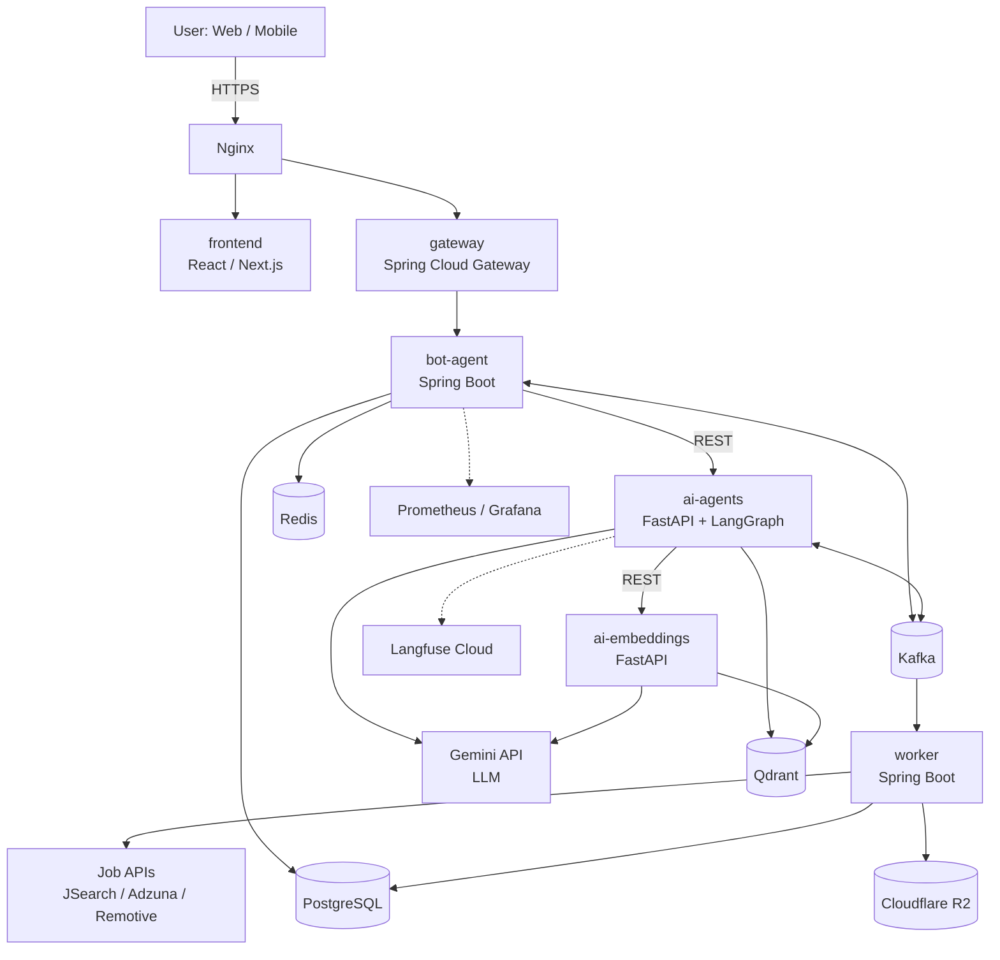

# ResultMatch Resume AI

> Trả lời câu hỏi – Phân tích thị trường AI, IT – Gợi ý lộ trình phù hợp với CV của bạn.

**ResultMatch Resume AI** là nền tảng chat AI giúp ứng viên, người đi làm và sinh viên IT hiểu CV của mình đang đứng ở đâu so với thị trường việc làm AI/IT, từ đó biết cần bổ sung gì và nên ứng tuyển vào đâu.

> 📖 **Tài liệu chi tiết:** Xem [Phân tích hệ thống, Use Case & Business Rules](README_ANALYSIS.md).


---

## Mục lục

1. [Tính năng chính](#1-tính-năng-chính)
2. [Vai trò người dùng](#2-vai-trò-người-dùng)
3. [Kiến trúc hệ thống](#3-kiến-trúc-hệ-thống)
4. [Công nghệ sử dụng](#4-công-nghệ-sử-dụng)
5. [Luồng xử lý chính](#5-luồng-xử-lý-chính)
6. [Lưu trữ dữ liệu](#6-lưu-trữ-dữ-liệu)
7. [Cấu trúc thư mục](#7-cấu-trúc-thư-mục)
8. [Cài đặt và chạy](#8-cài-đặt-và-chạy)
9. [Biến môi trường](#9-biến-môi-trường)
10. [Quy ước phát triển](#10-quy-ước-phát-triển)
11. [Lộ trình phát triển](#11-lộ-trình-phát-triển)
12. [Lưu ý bảo mật và dữ liệu cá nhân](#12-lưu-ý-bảo-mật-và-dữ-liệu-cá-nhân)
13. [Giấy phép và tác giả](#13-giấy-phép-và-tác-giả)

---

## 1. Tính năng chính

### 1.1 Phân tích CV
- Upload CV (PDF/DOCX), lưu trên Cloudflare R2. CV dạng ảnh scan (OCR) sẽ hỗ trợ ở giai đoạn sau.
- Trích xuất kỹ năng, kinh nghiệm, học vấn bằng Gemini với structured output (JSON schema).
- Chuẩn hóa tên kỹ năng theo cơ chế 3 tầng (xem mục 5.6).
- Đánh giá điểm mạnh, điểm yếu và gợi ý cải thiện.
- Xử lý bất đồng bộ qua Kafka, báo tiến trình và kết quả qua WebSocket.

### 1.2 Hỏi đáp thị trường
- Chat với bot về xu hướng, kỹ năng được yêu cầu, mức yêu cầu tuyển dụng.
- Dữ liệu lấy từ các job API (JSearch, Adzuna, Remotive), **không tự cào dữ liệu**. Trọng tâm là thị trường Việt Nam, bổ sung dữ liệu quốc tế.
- Agent chọn công cụ theo loại câu hỏi:

| Loại câu hỏi | Ví dụ | Cách xử lý |
|---|---|---|
| Thống kê | "Kỹ năng nào được yêu cầu nhiều nhất cho Java dev?" | Truy vấn SQL tổng hợp trên PostgreSQL |
| Mô tả, xu hướng | "AI engineer thường yêu cầu gì?" | RAG trên Qdrant |
| Cần dữ liệu mới | "Tin tuyển dụng mới nhất về..." | Gọi job API trực tiếp (có cache Redis) |

- Trả lời dạng streaming, kèm nguồn (link tin gốc).

### 1.3 Tư vấn lộ trình
- So sánh kỹ năng trong CV với vị trí mục tiêu, tính ra **skill gap** từ dữ liệu tuyển dụng thật.
- Gemini dùng skill gap để viết lộ trình học theo giai đoạn.
- Lưu lộ trình, tạo lại khi cập nhật CV.

### 1.4 Tìm việc và gợi ý việc phù hợp
- So khớp embedding CV với embedding tin tuyển dụng trong Qdrant.
- Xếp hạng lại bằng điểm tổng hợp: độ tương đồng embedding, tỷ lệ trùng khớp kỹ năng, mức phù hợp cấp bậc/địa điểm.
- Hiển thị lý do phù hợp (kỹ năng đã có, kỹ năng còn thiếu).
- Lưu tin quan tâm.

---

## 2. Vai trò người dùng

| Vai trò | Mô tả | Quyền chính |
|---|---|---|
| **Guest** | Chưa đăng nhập | Xem giới thiệu, đăng ký/đăng nhập, hỏi đáp thị trường giới hạn lượt |
| **User** | Ứng viên, người đi làm, sinh viên IT | Upload và phân tích CV, chat, tư vấn lộ trình, tìm việc, nhận thông báo |
| **Admin** | Quản trị hệ thống | Quản lý người dùng, nguồn dữ liệu thị trường, giám sát chất lượng AI, cấu hình prompt/model |

Admin **không** xem được nội dung CV hay hội thoại riêng của User.

| Chức năng | Guest | User | Admin |
|---|:-:|:-:|:-:|
| Xem trang giới thiệu | ✓ | ✓ | ✓ |
| Hỏi đáp thị trường (giới hạn lượt) | ✓ | | |
| Hỏi đáp thị trường (không giới hạn) | | ✓ | ✓ |
| Upload và phân tích CV | | ✓ | |
| Tư vấn lộ trình | | ✓ | |
| Tìm việc và gợi ý theo CV | | ✓ | |
| Quản lý người dùng | | | ✓ |
| Quản lý nguồn dữ liệu thị trường | | | ✓ |
| Xem trace, log, dashboard | | | ✓ |

---

## 3. Kiến trúc hệ thống

Kiến trúc microservice, chạy bằng Docker Compose, theo hướng **hybrid Java + Python**: nghiệp vụ và hạ tầng bằng Java (Spring Boot), phần AI bằng Python (FastAPI + LangGraph). Các service giao tiếp đồng bộ bằng REST và bất đồng bộ qua Kafka.



### Các service

| Service | Công nghệ | Vai trò |
|---|---|---|
| `frontend` | React / Next.js | Chat UI, upload CV, xem kết quả, tìm việc |
| `gateway` | Spring Cloud Gateway | Kiểm tra JWT, rate limit, định tuyến nội bộ |
| `bot-agent` | Spring Boot | Quản lý hội thoại, WebSocket, lưu lịch sử, điều phối gọi `ai-agents` |
| `ai-agents` | FastAPI + LangGraph | Agent hỏi đáp thị trường, tư vấn lộ trình, tool calling, RAG |
| `ai-embeddings` | FastAPI | Điểm duy nhất gọi API embedding: gom batch, cache Redis, xử lý giới hạn tốc độ, đọc/ghi Qdrant |
| `worker` | Spring Boot + spring-kafka | Tác vụ nền: xử lý CV, nạp dữ liệu việc làm, gửi thông báo |

---

## 4. Công nghệ sử dụng

### 4.1 Ngôn ngữ và framework

| Công nghệ | Dùng để làm gì |
|---|---|
| Java 21 + Spring Boot 3 | Backend chính: `gateway`, `bot-agent`, `worker`, xác thực, quản lý CV và tin tuyển dụng |
| Maven | Build và quản lý dependency cho các service Java |
| Python + FastAPI | Hai service AI: `ai-agents`, `ai-embeddings` |
| LangGraph | Điều phối agent hỏi đáp thị trường: phân loại câu hỏi, chọn công cụ, tổng hợp câu trả lời |
| LangChain | Thư viện hỗ trợ trong LangGraph: gọi LLM, định nghĩa tool, retriever |
| React / Next.js | Giao diện người dùng |

### 4.2 Cổng vào và giao tiếp

| Công nghệ | Dùng để làm gì |
|---|---|
| Nginx | Điểm vào duy nhất: SSL, routing, load balancing |
| Spring Cloud Gateway | API Gateway: xác thực JWT, rate limit, định tuyến đến các service |
| REST API | Giao tiếp đồng bộ giữa client, gateway và các service (kể cả Java ↔ Python) |
| WebSocket | Stream câu trả lời, tiến trình phân tích CV, thông báo |
| Kafka | Hàng đợi sự kiện, cầu nối bất đồng bộ giữa Java và Python |

### 4.3 Lưu trữ

| Công nghệ | Dùng để làm gì |
|---|---|
| PostgreSQL | Tài khoản, hồ sơ CV đã trích xuất, tin tuyển dụng, kỹ năng, lộ trình, lịch sử chat, log; chạy truy vấn thống kê cho agent |
| Redis | Cache kết quả job API và embedding, session, ngữ cảnh hội thoại ngắn hạn, đếm lượt dùng của Guest |
| Qdrant | Lưu embedding CV và tin tuyển dụng cho RAG và so khớp |
| Cloudflare R2 | Lưu file CV gốc và tài liệu (tương thích API S3) |

### 4.4 AI

| Công nghệ | Dùng để làm gì |
|---|---|
| Gemini (API) | Trích xuất CV, đánh giá, viết lộ trình, trả lời chat |
| Gemini Embedding (`gemini-embedding-001`, 768 chiều) | Vector hóa CV và tin tuyển dụng; đa ngôn ngữ |
| RAG | Truy xuất dữ liệu thị trường để trả lời |
| Tool calling | Agent gọi SQL thống kê, job API, tìm kiếm Qdrant |
| Structured output (JSON schema) | Ép LLM trả dữ liệu đúng cấu trúc khi trích xuất CV |
| Multi-agent | Phối hợp nhiều agent chuyên biệt cho tác vụ phức tạp |

### 4.5 Xử lý dữ liệu và nguồn dữ liệu

| Công nghệ | Dùng để làm gì |
|---|---|
| Apache Tika / PDFBox | Đọc văn bản từ PDF, DOCX |
| Tesseract OCR *(giai đoạn sau)* | Đọc CV dạng ảnh scan |
| JSearch (RapidAPI) | Nguồn chính lấy tin tuyển dụng, kể cả việc ở Việt Nam |
| Adzuna | Số liệu thống kê (mức lương, xu hướng) |
| Remotive | Bổ sung việc làm remote |
| Bảng kỹ năng + alias | Chuẩn hóa tên kỹ năng |

### 4.6 Truy cập dữ liệu

| Công nghệ | Dùng để làm gì |
|---|---|
| Spring Data JPA + Flyway | Truy cập PostgreSQL và quản lý migration |
| Spring Data Redis | Truy cập Redis |
| spring-kafka | Producer/consumer Kafka bên Java |
| qdrant-java client | Truy cập Qdrant bên Java |
| AWS SDK for S3 (Java) / boto3 (Python) | Truy cập Cloudflare R2 |

### 4.7 Bảo mật

| Công nghệ | Dùng để làm gì |
|---|---|
| Spring Security + JWT | Đăng nhập, phân quyền Guest/User/Admin |
| Docker secrets / biến môi trường | Giữ API key ngoài mã nguồn |

### 4.8 Vận hành và giám sát

| Công nghệ | Dùng để làm gì |
|---|---|
| Docker + Docker Compose | Đóng gói và chạy toàn bộ hệ thống |
| Langfuse Cloud | Theo dõi từng lượt gọi LLM: prompt, độ trễ, chi phí, đánh giá |
| Prometheus + Grafana | Thu thập metrics và dashboard |
| Micrometer / Spring Actuator | Xuất metrics từ service Java |
| OpenTelemetry | Truy vết yêu cầu xuyên service Java và Python |
| Portainer | Quản lý container qua giao diện web |

### 4.9 Kiểm thử và phát triển

| Công nghệ | Dùng để làm gì |
|---|---|
| JUnit + Testcontainers | Test Java, kèm Postgres/Kafka thật trong container |
| pytest | Test service Python |
| Swagger / OpenAPI | Tài liệu API, làm hợp đồng giữa Java và Python |
| Git + GitHub Actions | Quản lý mã nguồn, CI (build và test tự động) |

---

## 5. Luồng xử lý chính

### 5.1 Phân tích CV (bất đồng bộ)

1. User upload file → kiểm tra loại file, dung lượng → lưu vào R2 → tạo bản ghi `cv` trạng thái `PENDING`.
2. Phát sự kiện `cv.uploaded` lên Kafka, API trả về ngay.
3. `worker` lấy file, trích xuất văn bản (Tika/PDFBox).
4. Gọi Gemini với structured output để trích xuất kỹ năng, kinh nghiệm, học vấn.
5. Chuẩn hóa kỹ năng (mục 5.6).
6. Gọi Gemini lần hai để đánh giá điểm mạnh, điểm yếu, gợi ý cải thiện.
7. Lưu kết quả, tạo embedding CV lưu vào Qdrant, cập nhật trạng thái `DONE`, báo user qua WebSocket.

### 5.2 Nạp dữ liệu việc làm (ingestion)

1. Scheduler hoặc Admin kích hoạt.
2. `worker` gọi các adapter job API (mỗi nguồn một adapter cùng interface `JobSource`).
3. Chuẩn hóa thành `JobPosting`, loại trùng.
4. Trích xuất và chuẩn hóa kỹ năng, tạo embedding.
5. Lưu vào Qdrant (vector) và PostgreSQL (dữ liệu có cấu trúc).

Không gọi job API trực tiếp mỗi lần user hỏi (gói miễn phí giới hạn request); agent truy vấn kho dữ liệu đã nạp, chỉ gọi API trực tiếp khi cần dữ liệu mới và có cache Redis.

### 5.3 Hỏi đáp thị trường

1. User gửi câu hỏi qua WebSocket → `bot-agent` → `ai-agents`.
2. Agent (LangGraph) phân loại câu hỏi → chọn SQL, RAG hoặc gọi job API.
3. Tổng hợp câu trả lời, stream về user, kèm nguồn.
4. Lưu lịch sử vào PostgreSQL, ngữ cảnh ngắn hạn ở Redis.

### 5.4 Tư vấn lộ trình

1. User chọn CV và vị trí mục tiêu.
2. Tổng hợp kỹ năng yêu cầu cho vị trí đó (kèm tần suất) từ kho tin tuyển dụng.
3. So với kỹ năng trong CV để ra skill gap (tính bằng code, không để LLM tự quyết).
4. Gemini viết lộ trình theo giai đoạn dựa trên skill gap.
5. Lưu lộ trình.

### 5.5 Gợi ý việc làm

1. Lấy embedding CV, tìm top-K trong Qdrant kèm bộ lọc (địa điểm, remote, cấp bậc).
2. Xếp hạng lại: độ tương đồng + trùng khớp kỹ năng + mức phù hợp.
3. Trả kết quả kèm lý do phù hợp.

> CV và tin tuyển dụng phải dùng **cùng một model embedding và cùng số chiều**. Số chiều được cố định khi tạo collection Qdrant; đổi sau đó phải nhúng lại toàn bộ dữ liệu.

### 5.6 Chuẩn hóa kỹ năng (3 tầng)

| Tầng | Cách làm | Khi nào dùng |
|---|---|---|
| 1. Bảng alias | Chuẩn hóa chuỗi (chữ thường, bỏ ký tự thừa) rồi tra bảng `skill_alias` → `skill` chuẩn | Luôn chạy trước; nhanh, chính xác, không tốn chi phí |
| 2. So khớp embedding | Tính độ tương đồng với danh sách kỹ năng chuẩn; nhận nếu vượt ngưỡng | Biến thể chưa có trong bảng alias |
| 3. LLM dự phòng | Hỏi Gemini kỹ năng này tương ứng kỹ năng chuẩn nào, hoặc là kỹ năng mới | Chỉ khi tầng 2 không chắc chắn |

Kết quả từ tầng 2 và 3 được lưu ở trạng thái chờ duyệt rồi bổ sung vào bảng alias, nên hệ thống dần ít phải gọi đến các tầng sau.

---

## 6. Lưu trữ dữ liệu

| Loại dữ liệu | Nơi lưu |
|---|---|
| Tài khoản, hồ sơ CV đã trích xuất, tin tuyển dụng, kỹ năng và alias, lộ trình | PostgreSQL |
| Lịch sử chat, log, metadata | PostgreSQL |
| File CV gốc, tài liệu | Cloudflare R2 (bucket private) |
| Embedding CV và tin tuyển dụng | Qdrant |
| Cache job API và embedding, session, ngữ cảnh chat ngắn hạn, bộ đếm lượt dùng | Redis |

---

## 7. Cấu trúc thư mục

```
resultmatch-resume-ai/
├── frontend/              # React / Next.js
├── gateway/               # Spring Cloud Gateway
├── bot-agent/             # Spring Boot
├── worker/                # Spring Boot + Kafka consumer
├── ai-agents/             # FastAPI + LangGraph
├── ai-embeddings/         # FastAPI
├── infra/
│   ├── nginx/
│   ├── prometheus/
│   └── grafana/
├── docs/                  # Tài liệu thiết kế, API contract
├── .github/workflows/     # GitHub Actions
├── docker-compose.yml
├── .env.example
├── LICENSE
├── README_ANALYSIS.md     # Phân tích hệ thống, use case, business rules
└── README.md
```

---

## 8. Cài đặt và chạy

### Yêu cầu

- Docker và Docker Compose
- JDK 21 và Maven (nếu chạy service Java ngoài Docker)
- Python 3.11+ (nếu chạy service AI ngoài Docker)
- Node.js 20+ (nếu chạy frontend ngoài Docker)
- Tài khoản và API key: Google AI (Gemini), JSearch (RapidAPI), Adzuna, Cloudflare R2, Langfuse Cloud

### Các bước

```bash
# 1. Clone dự án
git clone https://github.com/<username>/resultmatch-resume-ai.git
cd resultmatch-resume-ai

# 2. Tạo file môi trường và điền giá trị
cp .env.example .env

# 3. Khởi động toàn bộ hệ thống
docker compose up -d --build

# 4. Kiểm tra trạng thái
docker compose ps
```

### Bảng port

| Thành phần | Port | Ghi chú |
|---|---|---|
| Nginx | 80 / 443 | Điểm vào duy nhất |
| frontend | 3000 | Next.js |
| gateway | 8080 | Spring Cloud Gateway |
| bot-agent | 8081 | |
| worker | 8082 | |
| ai-agents | 8000 | FastAPI |
| ai-embeddings | 8001 | FastAPI |
| PostgreSQL | 5432 | |
| Redis | 6379 | |
| Kafka | 9092 | |
| Qdrant | 6333 (REST) / 6334 (gRPC) | |
| Prometheus | 9090 | |
| Grafana | 3001 | Dời khỏi 3000 để không đụng frontend |
| Portainer | 9443 | |

Ngoài Nginx, nên chỉ mở các port còn lại ở môi trường phát triển; khi triển khai thật, giữ chúng trong mạng nội bộ của Docker.

### Địa chỉ truy cập (môi trường phát triển)

| Thành phần | Địa chỉ |
|---|---|
| Ứng dụng web | `http://localhost` |
| Swagger (API) | `http://localhost:8080/swagger-ui.html` |
| Grafana | `http://localhost:3001` |
| Portainer | `https://localhost:9443` |

---

## 9. Biến môi trường

Tạo file `.env` từ `.env.example`. **Không commit file `.env` lên Git.**

```env
# --- Ứng dụng ---
JWT_SECRET=<chuỗi-bí-mật-dài>

# --- PostgreSQL ---
POSTGRES_DB=resultmatch
POSTGRES_USER=<user>
POSTGRES_PASSWORD=<password>

# --- Redis / Kafka / Qdrant ---
REDIS_URL=redis://redis:6379
KAFKA_BOOTSTRAP_SERVERS=kafka:9092
QDRANT_URL=http://qdrant:6333

# --- Cloudflare R2 (tương thích S3) ---
R2_ENDPOINT=https://<account-id>.r2.cloudflarestorage.com
R2_ACCESS_KEY_ID=<access-key>
R2_SECRET_ACCESS_KEY=<secret-key>
R2_BUCKET=<tên-bucket>

# --- Gemini ---
GEMINI_API_KEY=<api-key>
GEMINI_MODEL=<tên-model-gemini-hiện-hành>
EMBEDDING_MODEL=gemini-embedding-001
EMBEDDING_DIM=768

# --- Job API ---
JSEARCH_RAPIDAPI_KEY=<key>
ADZUNA_APP_ID=<id>
ADZUNA_APP_KEY=<key>

# --- Langfuse Cloud ---
LANGFUSE_PUBLIC_KEY=<key>
LANGFUSE_SECRET_KEY=<key>
LANGFUSE_HOST=<địa-chỉ-langfuse-cloud-của-bạn>
```

---

## 10. Quy ước phát triển

### 10.1 Quy trình nhánh (Git Flow)

| Nhánh | Mục đích |
|---|---|
| `main` | Bản ổn định, mỗi lần gộp tương ứng một phiên bản (gắn tag) |
| `develop` | Nhánh tích hợp, nơi gom các tính năng đã xong |
| `feature/<tên-ngắn>` | Phát triển một tính năng, tách từ `develop`, gộp lại vào `develop` |
| `release/<phiên-bản>` | Chuẩn bị phát hành, tách từ `develop`, gộp vào `main` và `develop` |
| `hotfix/<tên-ngắn>` | Sửa lỗi gấp trên `main`, gộp vào `main` và `develop` |

Ví dụ: `feature/cv-analysis`, `feature/job-ingestion`, `release/1.0.0`, `hotfix/jwt-expiry`.

### 10.2 Quy ước commit (Conventional Commits)

Định dạng: `<type>(<scope>): <mô tả ngắn>`

| Type | Dùng khi |
|---|---|
| `feat` | Thêm tính năng |
| `fix` | Sửa lỗi |
| `docs` | Chỉ thay đổi tài liệu |
| `refactor` | Cấu trúc lại code, không đổi hành vi |
| `test` | Thêm hoặc sửa test |
| `chore` | Việc vặt: cấu hình, dependency, build |
| `ci` | Thay đổi pipeline CI |

Scope là tên service hoặc module, ví dụ `worker`, `ai-agents`, `gateway`, `cv`.

```
feat(cv): add async CV analysis via Kafka
fix(gateway): reject expired JWT with 401
docs(readme): update architecture diagram
```

### 10.3 Quy ước khác

- Không commit trực tiếp lên `main` và `develop`; làm trên nhánh `feature/*`.
- Mỗi commit nên nhỏ, làm một việc.
- Mọi thay đổi thành công của CI (build và test) trước khi gộp.

---

## 11. Lộ trình phát triển

| Giai đoạn | Nội dung |
|---|---|
| **0. Nền tảng** | Đăng nhập (JWT), upload file lên R2, Docker Compose cơ bản |
| **1. Phân tích CV** | Parse CV, trích xuất bằng Gemini, đánh giá, thông báo qua WebSocket |
| **2. Dữ liệu thị trường** | Adapter job API, pipeline ingestion, chuẩn hóa kỹ năng |
| **3. Gợi ý việc làm** | Embedding, Qdrant, xếp hạng lại, giải thích lý do phù hợp |
| **4. Tư vấn lộ trình** | Tính skill gap, sinh lộ trình bằng Gemini |
| **5. Hỏi đáp thị trường** | Agent LangGraph (SQL + RAG + gọi API), streaming |
| **6. Quản trị và giám sát** | Màn hình Admin, Langfuse, Prometheus, Grafana |
| **Mở rộng (sau)** | OCR cho CV scan, role Nhà tuyển dụng, đa ngôn ngữ giao diện |

---

## 12. Lưu ý bảo mật và dữ liệu cá nhân

- CV chứa dữ liệu cá nhân: bucket R2 để **private**, tải file qua **presigned URL** có hạn ngắn.
- Che thông tin nhạy cảm (số điện thoại, email, địa chỉ) trước khi gửi nội dung CV cho Gemini.
- API key lưu trong biến môi trường hoặc Docker secrets, không đưa vào mã nguồn.
- Kiểm tra điều khoản sử dụng của từng job API trước khi lưu dữ liệu lâu dài; luôn giữ link tin gốc.
- Cho phép User xóa CV và dữ liệu liên quan của mình.

---

## 13. Giấy phép và tác giả

- Giấy phép: [MIT](LICENSE)
- Tác giả: **Huỳnh Văn Hào**
