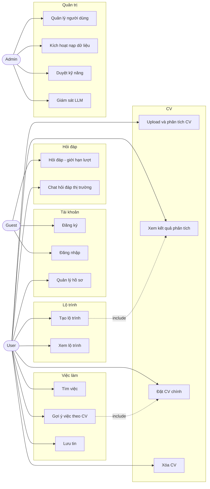
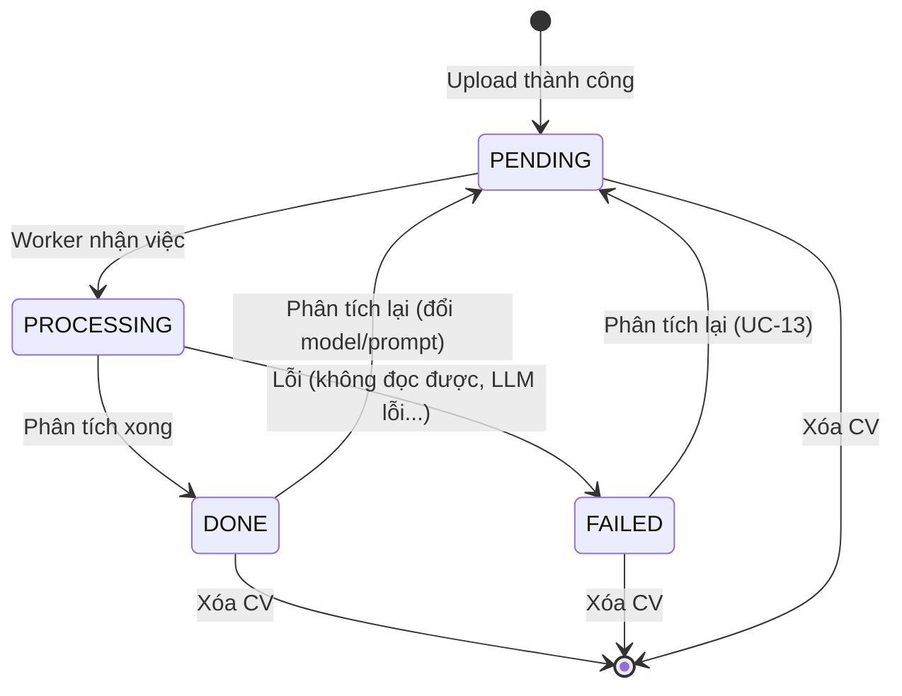

# ResultMatch Resume AI – Phân tích hệ thống

Tài liệu tổng hợp **vai trò, use case, phân tích hệ thống và business rule** của dự án. Đọc cùng [README.md](README.md) (kiến trúc, công nghệ, cách chạy).

> Các giá trị đánh dấu *(đề xuất)* chưa được chốt và có thể cấu hình lại.

---

## Mục lục

1. [Phạm vi và mục tiêu](#1-phạm-vi-và-mục-tiêu)
2. [Actor và vai trò](#2-actor-và-vai-trò)
3. [Ma trận phân quyền](#3-ma-trận-phân-quyền)
4. [Danh sách use case](#4-danh-sách-use-case)
5. [Sơ đồ use case](#5-sơ-đồ-use-case)
6. [Đặc tả các use case chính](#6-đặc-tả-các-use-case-chính)
7. [Phân tích hệ thống](#7-phân-tích-hệ-thống)
8. [Business rules](#8-business-rules)
9. [Giả định, ràng buộc và điểm còn mở](#9-giả-định-ràng-buộc-và-điểm-còn-mở)

---

## 1. Phạm vi và mục tiêu

**Mục tiêu:** giúp ứng viên, người đi làm và sinh viên IT biết CV của mình đang đứng ở đâu so với thị trường việc làm AI/IT, cần bổ sung gì và nên ứng tuyển vào đâu.

**Trong phạm vi:**
- Phân tích CV (PDF/DOCX) và đánh giá điểm mạnh, điểm yếu.
- Hỏi đáp về thị trường việc làm bằng chat.
- Tư vấn lộ trình dựa trên khoảng cách kỹ năng (skill gap).
- Tìm việc và gợi ý việc phù hợp với CV.
- Quản trị người dùng, nguồn dữ liệu và giám sát chất lượng AI.

**Ngoài phạm vi (giai đoạn này):**
- Role Nhà tuyển dụng (đăng tin, tìm ứng viên).
- OCR cho CV dạng ảnh scan.
- Tự cào dữ liệu việc làm (chỉ dùng job API).
- Nộp đơn ứng tuyển trực tiếp trên hệ thống (chỉ dẫn đến link tin gốc).
- Giao diện đa ngôn ngữ.

**Thị trường mục tiêu:** Việt Nam là chính, dữ liệu quốc tế bổ sung.

---

## 2. Actor và vai trò

### 2.1 Actor người dùng

| Vai trò | Mô tả | Cách có được |
|---|---|---|
| **Guest** | Người truy cập chưa đăng nhập | Mặc định |
| **User** | Ứng viên, người đi làm, sinh viên IT, người quan tâm thị trường AI | Tự đăng ký |
| **Admin** | Quản trị hệ thống | Do hệ thống khởi tạo (seed) hoặc Admin khác tạo; **không tự đăng ký** |

Ba nhóm đối tượng trong sơ đồ gốc (ứng viên, sinh viên, người quan tâm thị trường) dùng chung bộ chức năng nên gộp thành một role **User**.

### 2.2 Actor hệ thống (không phải người)

| Actor | Vai trò |
|---|---|
| **Scheduler** | Kích hoạt nạp dữ liệu việc làm định kỳ |
| **Worker** | Xử lý tác vụ nền (phân tích CV, nạp dữ liệu, thông báo, dọn dữ liệu) |
| **AI Agent** | Xử lý hội thoại, gọi công cụ (SQL, RAG, job API) |
| **Gemini API** | LLM và embedding bên ngoài |
| **Job API** | JSearch, Adzuna, Remotive |

---

## 3. Ma trận phân quyền

| Chức năng | Guest | User | Admin |
|---|:-:|:-:|:-:|
| Xem trang giới thiệu | ✓ | ✓ | ✓ |
| Đăng ký, đăng nhập | ✓ | | |
| Hỏi đáp thị trường (giới hạn lượt) | ✓ | | |
| Hỏi đáp thị trường (theo hạn mức User) | | ✓ | ✓ |
| Quản lý hồ sơ cá nhân | | ✓ | ✓ |
| Upload, xem, xóa CV của mình | | ✓ | |
| Xem kết quả phân tích CV của mình | | ✓ | |
| Tạo, xem, xóa lộ trình của mình | | ✓ | |
| Tìm việc, xem gợi ý theo CV | | ✓ | |
| Lưu, bỏ lưu tin tuyển dụng | | ✓ | |
| Xem lịch sử hội thoại của mình | | ✓ | |
| Nhận và xem thông báo | | ✓ | ✓ |
| Quản lý người dùng (xem, khóa, mở khóa) | | | ✓ |
| Quản lý nguồn dữ liệu, kích hoạt nạp dữ liệu | | | ✓ |
| Duyệt kỹ năng và alias chờ duyệt | | | ✓ |
| Xem trace LLM, log, dashboard | | | ✓ |
| Cấu hình prompt, model, hạn mức | | | ✓ |
| Đọc nội dung CV, hội thoại riêng của User | | | ✗ |

Admin **không** đọc được nội dung CV và hội thoại của User (xem BR-D1).

---

## 4. Danh sách use case

**Ưu tiên:** P1 = MVP, P2 = làm sau MVP, P3 = tùy chọn.

### 4.1 Tài khoản

| ID | Use case | Actor | Ưu tiên |
|---|---|---|:-:|
| UC-01 | Đăng ký tài khoản | Guest | P1 |
| UC-02 | Đăng nhập | Guest | P1 |
| UC-03 | Đăng xuất | User, Admin | P1 |
| UC-04 | Xem và cập nhật hồ sơ cá nhân | User, Admin | P2 |
| UC-05 | Đổi mật khẩu | User, Admin | P2 |
| UC-06 | Xóa tài khoản | User | P2 |

### 4.2 CV

| ID | Use case | Actor | Ưu tiên |
|---|---|---|:-:|
| UC-07 | Upload CV và yêu cầu phân tích | User | P1 |
| UC-08 | Xem kết quả phân tích CV | User | P1 |
| UC-09 | Xem danh sách CV | User | P1 |
| UC-10 | Đặt CV chính | User | P1 |
| UC-11 | Tải lại file CV gốc | User | P2 |
| UC-12 | Xóa CV | User | P1 |
| UC-13 | Phân tích lại CV (khi lỗi hoặc đổi model) | User | P2 |

### 4.3 Hỏi đáp thị trường

| ID | Use case | Actor | Ưu tiên |
|---|---|---|:-:|
| UC-14 | Hỏi đáp thị trường (giới hạn lượt) | Guest | P2 |
| UC-15 | Chat hỏi đáp thị trường | User | P1 |
| UC-16 | Xem lại hội thoại cũ | User | P2 |
| UC-17 | Xóa hội thoại | User | P2 |

### 4.4 Lộ trình

| ID | Use case | Actor | Ưu tiên |
|---|---|---|:-:|
| UC-18 | Tạo lộ trình theo vị trí mục tiêu | User | P1 |
| UC-19 | Xem lộ trình đã lưu | User | P1 |
| UC-20 | Xóa lộ trình | User | P2 |

### 4.5 Tìm việc

| ID | Use case | Actor | Ưu tiên |
|---|---|---|:-:|
| UC-21 | Tìm kiếm việc làm theo từ khóa, bộ lọc | User | P1 |
| UC-22 | Xem gợi ý việc phù hợp với CV | User | P1 |
| UC-23 | Xem chi tiết tin tuyển dụng | User | P1 |
| UC-24 | Lưu, bỏ lưu tin tuyển dụng | User | P2 |
| UC-25 | Xem danh sách tin đã lưu | User | P2 |

### 4.6 Thông báo

| ID | Use case | Actor | Ưu tiên |
|---|---|---|:-:|
| UC-26 | Nhận thông báo thời gian thực | User, Admin | P1 |
| UC-27 | Xem và đánh dấu đã đọc thông báo | User, Admin | P2 |

### 4.7 Quản trị

| ID | Use case | Actor | Ưu tiên |
|---|---|---|:-:|
| UC-28 | Quản lý người dùng (xem, khóa, mở khóa) | Admin | P2 |
| UC-29 | Kích hoạt nạp dữ liệu việc làm thủ công | Admin | P1 |
| UC-30 | Xem lịch sử các lần nạp dữ liệu | Admin | P2 |
| UC-31 | Duyệt kỹ năng và alias chờ duyệt | Admin | P2 |
| UC-32 | Xem trace LLM và dashboard giám sát | Admin | P2 |
| UC-33 | Cấu hình prompt, model, hạn mức | Admin | P3 |

### 4.8 Use case của hệ thống

| ID | Use case | Actor | Ưu tiên |
|---|---|---|:-:|
| UC-S1 | Nạp dữ liệu việc làm định kỳ | Scheduler, Worker | P1 |
| UC-S2 | Xử lý phân tích CV nền | Worker | P1 |
| UC-S3 | Dọn dữ liệu liên quan khi xóa CV hoặc tài khoản (R2, Qdrant) | Worker | P2 |
| UC-S4 | Đánh dấu tin tuyển dụng hết hạn | Scheduler | P2 |

---

## 5. Sơ đồ use case

---

## 6. Đặc tả các use case chính

### UC-07: Upload CV và yêu cầu phân tích

| Mục | Nội dung |
|---|---|
| Actor | User |
| Điều kiện trước | Đã đăng nhập; chưa vượt số CV tối đa (BR-C2) |
| Điều kiện sau (thành công) | CV lưu ở R2, bản ghi `cv` ở trạng thái `PENDING`, sự kiện đã vào Kafka; user nhận được phản hồi ngay |

**Luồng chính**
1. User chọn file CV và gửi lên.
2. Hệ thống kiểm tra loại file, dung lượng (BR-C1).
3. Hệ thống lưu file vào R2 (private), tạo bản ghi `cv` trạng thái `PENDING`.
4. Hệ thống phát sự kiện `cv.uploaded` lên Kafka và trả về ngay mã CV và trạng thái.
5. Worker xử lý nền (UC-S2); giao diện hiển thị tiến trình qua WebSocket.
6. Khi xong, hệ thống gửi thông báo (UC-26) và cập nhật trạng thái `DONE`.

**Luồng thay thế / ngoại lệ**
- 2a. Sai định dạng hoặc quá dung lượng → từ chối, báo lý do cụ thể.
- 2b. Đã đủ số CV tối đa → yêu cầu xóa bớt CV cũ.
- 5a. Không trích xuất được văn bản (file scan, file hỏng) → trạng thái `FAILED`, thông báo rõ nguyên nhân (BR-C9).
- 5b. Gemini lỗi hoặc trả dữ liệu sai schema → thử lại tối đa 2 lần (BR-L1), vẫn lỗi thì `FAILED` và cho phép UC-13.

### UC-S2: Xử lý phân tích CV nền

| Mục | Nội dung |
|---|---|
| Actor | Worker, Gemini API |
| Kích hoạt | Sự kiện `cv.uploaded` hoặc yêu cầu phân tích lại |

**Luồng chính**
1. Chuyển CV sang `PROCESSING`.
2. Tải file từ R2, trích xuất văn bản (Tika/PDFBox).
3. Che thông tin nhạy cảm (BR-C5).
4. Gọi Gemini với structured output để trích xuất kỹ năng, kinh nghiệm, học vấn; kiểm tra theo JSON schema.
5. Chuẩn hóa kỹ năng theo 3 tầng (BR-S1).
6. Gọi Gemini lần hai để đánh giá điểm mạnh, điểm yếu, gợi ý cải thiện.
7. Lưu `cv_analysis` và `cv_skill` (kèm `model_name`, `prompt_version`), tạo embedding và lưu vào Qdrant.
8. Chuyển CV sang `DONE`, tạo thông báo.

### UC-15: Chat hỏi đáp thị trường

| Mục | Nội dung |
|---|---|
| Actor | User, AI Agent |
| Điều kiện trước | Đã đăng nhập; còn hạn mức trong ngày (BR-H2) |
| Điều kiện sau | Câu hỏi và câu trả lời được lưu vào `conversation`/`message` |

**Luồng chính**
1. User gửi câu hỏi (qua WebSocket).
2. `bot-agent` nạp ngữ cảnh gần nhất (BR-H6) và chuyển cho AI Agent.
3. AI Agent phân loại câu hỏi:
   - Thống kê → truy vấn SQL trên PostgreSQL (BR-H3).
   - Mô tả, xu hướng → RAG trên Qdrant.
   - Cần dữ liệu mới → gọi job API (có cache Redis).
4. AI Agent tổng hợp câu trả lời kèm nguồn (BR-H4) và stream về user.
5. Hệ thống lưu tin nhắn và metadata (nguồn, công cụ đã gọi, trace id).

**Luồng thay thế / ngoại lệ**
- 1a. Hết hạn mức → thông báo và gợi ý thử lại sau.
- 3a. Câu hỏi ngoài phạm vi (BR-H5) → từ chối lịch sự, hướng về chủ đề được hỗ trợ.
- 3b. Không đủ dữ liệu để trả lời → nói rõ là chưa đủ dữ liệu, không bịa số liệu.
- 3c. Job API lỗi hoặc hết quota → dùng dữ liệu đã nạp và nói rõ dữ liệu có thể chưa mới nhất.

### UC-14: Hỏi đáp thị trường dành cho Guest

Giống UC-15 nhưng: chỉ truy cập dữ liệu thị trường chung (không có CV), không lưu lịch sử vào tài khoản, đếm lượt bằng Redis theo IP/session (BR-H1). Khi hết lượt, mời đăng ký/đăng nhập.

### UC-18: Tạo lộ trình theo vị trí mục tiêu

| Mục | Nội dung |
|---|---|
| Actor | User |
| Điều kiện trước | Có ít nhất một CV ở trạng thái `DONE` (BR-R2) |
| Điều kiện sau | Lộ trình được lưu vào `career_roadmap` |

**Luồng chính**
1. User chọn CV (mặc định CV chính) và nhập vị trí mục tiêu.
2. Hệ thống tổng hợp các kỹ năng yêu cầu cho vị trí đó và tần suất từ kho tin tuyển dụng.
3. Hệ thống tính **skill gap** bằng code (BR-R1).
4. Gemini viết lộ trình theo giai đoạn dựa trên skill gap (BR-R4).
5. Hệ thống lưu và hiển thị lộ trình cùng danh sách kỹ năng thiếu.

**Luồng thay thế / ngoại lệ**
- 2a. Số tin tuyển dụng phù hợp quá ít → vẫn tạo nhưng cảnh báo độ tin cậy thấp (BR-R3).
- 2b. Không nhận diện được vị trí mục tiêu → gợi ý các vị trí gần nhất có trong dữ liệu.

### UC-22: Xem gợi ý việc phù hợp với CV

| Mục | Nội dung |
|---|---|
| Actor | User |
| Điều kiện trước | Có CV `DONE` (mặc định dùng CV chính, BR-M4) |

**Luồng chính**
1. User mở trang gợi ý việc, có thể chọn bộ lọc (địa điểm, remote, cấp bậc).
2. Hệ thống lấy embedding CV, tìm top-K trong Qdrant kèm bộ lọc, chỉ tin còn hiệu lực (BR-M5).
3. Hệ thống xếp hạng lại bằng điểm tổng hợp (BR-M2).
4. Hệ thống hiển thị kết quả kèm **lý do phù hợp**: kỹ năng đã có, kỹ năng còn thiếu (BR-M3) và link tin gốc.

**Luồng thay thế:** chưa có CV `DONE` → hướng dẫn upload CV trước (UC-07).

### UC-29 / UC-S1: Nạp dữ liệu việc làm

| Mục | Nội dung |
|---|---|
| Actor | Admin (thủ công) hoặc Scheduler (định kỳ); Worker thực hiện |
| Điều kiện sau | Tin mới được chuẩn hóa, loại trùng, gắn kỹ năng, embedding và lưu |

**Luồng chính**
1. Kích hoạt (Scheduler theo lịch hoặc Admin chọn nguồn và truy vấn).
2. Tạo bản ghi `ingestion_run` trạng thái `RUNNING`.
3. Worker gọi adapter của từng nguồn, chuẩn hóa thành `JobPosting`.
4. Loại trùng theo `(source, source_job_id)` và `content_hash` (BR-J2, BR-J3).
5. Trích xuất và chuẩn hóa kỹ năng, tạo embedding, lưu PostgreSQL và Qdrant.
6. Cập nhật `ingestion_run` (số tin lấy được, số tin mới, trạng thái).

**Luồng thay thế / ngoại lệ**
- 3a. Một nguồn lỗi hoặc hết quota → ghi lỗi, tiếp tục các nguồn khác (BR-J8).

---

## 7. Phân tích hệ thống

### 7.1 Yêu cầu chức năng (tóm tắt)

| Nhóm | Yêu cầu |
|---|---|
| FR-1 Tài khoản | Đăng ký, đăng nhập bằng JWT, phân quyền Guest/User/Admin |
| FR-2 CV | Upload, trích xuất, đánh giá, quản lý nhiều CV, đặt CV chính |
| FR-3 Hỏi đáp | Chat streaming, chọn công cụ theo loại câu hỏi, trả lời có nguồn |
| FR-4 Lộ trình | Tính skill gap bằng code, sinh lộ trình bằng LLM, lưu lịch sử |
| FR-5 Tìm việc | Tìm kiếm, gợi ý theo embedding và độ trùng khớp kỹ năng, lưu tin |
| FR-6 Dữ liệu | Nạp từ job API, loại trùng, chuẩn hóa kỹ năng, đánh dấu hết hạn |
| FR-7 Thông báo | Đẩy thời gian thực qua WebSocket, lưu để xem lại |
| FR-8 Quản trị | Quản lý người dùng, nguồn dữ liệu, duyệt kỹ năng, giám sát, cấu hình |

### 7.2 Yêu cầu phi chức năng

| Nhóm | Yêu cầu *(đề xuất)* |
|---|---|
| Hiệu năng | API upload phản hồi nhanh (xử lý bất đồng bộ); phân tích CV thông thường hoàn tất trong vòng khoảng 1 phút; chat bắt đầu stream trong vài giây |
| Độ tin cậy | Tác vụ nền thử lại được; lỗi một nguồn dữ liệu không làm hỏng các nguồn khác |
| Bảo mật | JWT, rate limit ở gateway, file CV private, che thông tin nhạy cảm trước khi gửi LLM, key trong biến môi trường |
| Quyền riêng tư | Người dùng xóa được CV và toàn bộ dữ liệu liên quan; Admin không đọc nội dung riêng |
| Chi phí | Giới hạn lượt dùng, cache embedding và kết quả job API, chỉ gọi LLM khi cần |
| Khả năng quan sát | Trace mỗi lượt gọi LLM (Langfuse), metrics (Prometheus/Grafana), truy vết xuyên service (OpenTelemetry) |
| Khả năng bảo trì | Adapter cho mỗi nguồn dữ liệu cùng interface; lưu `model_name`, `prompt_version` để truy vết |
| Chất lượng AI | Structured output có kiểm tra schema; số liệu thống kê tính bằng SQL, không để LLM tự đếm |

### 7.3 Vòng đời trạng thái của CV

### 7.4 Phân vai các thành phần trong từng chức năng

| Chức năng | Java (Spring Boot) | Python (FastAPI) | Dữ liệu |
|---|---|---|---|
| Phân tích CV | `bot-agent` nhận upload; `worker` điều phối, trích xuất văn bản, lưu kết quả | Gọi Gemini (trích xuất, đánh giá), `ai-embeddings` tạo vector | R2, PostgreSQL, Qdrant, Kafka |
| Hỏi đáp thị trường | `bot-agent` quản lý hội thoại và WebSocket | `ai-agents` (LangGraph) chọn công cụ, tổng hợp câu trả lời | PostgreSQL (SQL), Qdrant (RAG), Redis |
| Tư vấn lộ trình | Tính skill gap bằng SQL | Gemini viết lộ trình | PostgreSQL |
| Gợi ý việc | Gọi tìm kiếm, xếp hạng lại | `ai-embeddings` tìm vector | Qdrant, PostgreSQL |
| Nạp dữ liệu | `worker`, adapter job API, Scheduler | `ai-embeddings` tạo vector | PostgreSQL, Qdrant, Redis |
| Thông báo | `worker` tạo, `bot-agent` đẩy qua WebSocket | | PostgreSQL |

### 7.5 Thực thể dữ liệu chính

| Thực thể | Quan hệ chính |
|---|---|
| `app_user` | 1 – n `cv`, `conversation`, `career_roadmap`, `saved_job`, `notification` |
| `cv` | 1 – 1 `cv_analysis`; n – n `skill` qua `cv_skill` |
| `skill` | 1 – n `skill_alias`; n – n `job_posting` qua `job_posting_skill` |
| `job_posting` | n – n `app_user` qua `saved_job` |
| `conversation` | 1 – n `message` |
| `ingestion_run` | Nhật ký các lần nạp dữ liệu |

Chi tiết cột, kiểu dữ liệu và index nằm trong script migration `V1__init.sql`.

---

## 8. Business rules

### 8.1 Tài khoản và phân quyền

| ID | Quy tắc |
|---|---|
| BR-A1 | Email là duy nhất; mật khẩu tối thiểu 8 ký tự và được băm (BCrypt) trước khi lưu. |
| BR-A2 | Người đăng ký mới luôn có role `USER`. Role `ADMIN` chỉ do hệ thống khởi tạo hoặc Admin khác cấp. |
| BR-A3 | Tài khoản `LOCKED` không đăng nhập được; token đang dùng bị từ chối ở lượt gọi tiếp theo. |
| BR-A4 | Mỗi yêu cầu API (trừ nhóm công khai) phải mang JWT còn hạn. User chỉ truy cập dữ liệu do chính mình sở hữu. |
| BR-A5 | Khi xóa tài khoản, hệ thống xóa toàn bộ dữ liệu của user: bản ghi PostgreSQL, file ở R2 và vector ở Qdrant (UC-S3). |

### 8.2 CV

| ID | Quy tắc |
|---|---|
| BR-C1 | Chỉ nhận PDF và DOCX, dung lượng tối đa 5 MB *(đề xuất)*; kiểm tra theo nội dung file, không chỉ dựa vào đuôi file. |
| BR-C2 | Mỗi user tối đa 5 CV *(đề xuất)*. |
| BR-C3 | Mỗi user có tối đa một CV chính. CV đầu tiên phân tích xong tự động thành CV chính *(đề xuất)*; user có thể đổi. |
| BR-C4 | Chỉ CV ở trạng thái `DONE` mới dùng được cho lộ trình và gợi ý việc. |
| BR-C5 | Che số điện thoại, email, địa chỉ trước khi gửi nội dung CV cho Gemini. |
| BR-C6 | File CV ở bucket **private**; tải file qua presigned URL hết hạn sau vài phút *(đề xuất: 5 phút)*. |
| BR-C7 | Chỉ chủ sở hữu được xem, tải, xóa CV và kết quả phân tích của CV đó. |
| BR-C8 | CV `FAILED` được phân tích lại tối đa 3 lần *(đề xuất)*. |
| BR-C9 | Nếu không trích xuất được văn bản (file scan, file hỏng), CV chuyển `FAILED` kèm thông báo rõ ràng. OCR sẽ hỗ trợ ở giai đoạn sau. |
| BR-C10 | Không lưu văn bản thô của CV trong cơ sở dữ liệu; chỉ lưu kết quả trích xuất có cấu trúc. |
| BR-C11 | Xóa CV phải xóa cả file ở R2 và vector ở Qdrant. Nếu CV đang `PROCESSING`, kết quả xử lý dở bị bỏ. Nếu là CV chính, hệ thống không tự chọn CV khác mà yêu cầu user chọn lại. |

### 8.3 Kỹ năng

| ID | Quy tắc |
|---|---|
| BR-S1 | Kỹ năng được chuẩn hóa theo 3 tầng: (1) bảng alias, (2) so khớp embedding vượt ngưỡng, (3) LLM dự phòng. Chỉ chuyển tầng khi tầng trước không chắc chắn. |
| BR-S2 | Alias do embedding hoặc LLM đề xuất ở trạng thái `PENDING` cho đến khi Admin duyệt; chỉ alias `APPROVED` được dùng ở tầng 1. |
| BR-S3 | Kỹ năng chưa chuẩn hóa được vẫn giữ tên gốc trong dữ liệu trích xuất nhưng **không tính** vào thống kê và skill gap cho tới khi được duyệt. |
| BR-S4 | Mọi so khớp tên kỹ năng dùng dạng đã chuẩn hóa chuỗi (chữ thường, bỏ ký tự thừa). |

### 8.4 Dữ liệu việc làm

| ID | Quy tắc |
|---|---|
| BR-J1 | Dữ liệu việc làm chỉ lấy qua job API chính thức, **không tự cào**. |
| BR-J2 | Một tin là duy nhất theo `(source, source_job_id)`. |
| BR-J3 | Tin trùng nội dung giữa các nguồn (cùng `content_hash`) chỉ giữ một bản, ưu tiên bản có dữ liệu đầy đủ hơn. |
| BR-J4 | Mọi tin phải lưu và hiển thị **link tin gốc**. |
| BR-J5 | Tin quá 60 ngày *(đề xuất)* hoặc nguồn báo đã hết hạn được đánh dấu `is_active = false` và bị loại khỏi gợi ý, thống kê. |
| BR-J6 | Tôn trọng giới hạn request của từng API: nạp theo lịch và qua cache Redis; không gọi API cho mỗi câu hỏi của user. |
| BR-J7 | Ưu tiên tin Việt Nam trong kết quả; tin quốc tế dùng để bổ sung và cho câu hỏi xu hướng toàn cầu. |
| BR-J8 | Lỗi ở một nguồn không chặn các nguồn khác; mỗi lần nạp ghi vào `ingestion_run`. |
| BR-J9 | Chỉ hiển thị mức lương nếu nguồn cung cấp; không suy đoán. |

### 8.5 Hỏi đáp (chat)

| ID | Quy tắc |
|---|---|
| BR-H1 | Guest được hỏi tối đa 5 câu mỗi ngày *(đề xuất)*, đếm theo IP/session trong Redis; chỉ truy cập dữ liệu thị trường chung, không truy cập CV, không lưu lịch sử vào tài khoản. |
| BR-H2 | User có hạn mức hỏi đáp mỗi ngày *(đề xuất: 100 tin nhắn)* để kiểm soát chi phí LLM; Admin cấu hình được. |
| BR-H3 | Câu hỏi thống kê (đếm, xếp hạng, tỷ lệ) phải trả lời bằng truy vấn SQL, **không** bằng RAG hoặc để LLM tự ước lượng. |
| BR-H4 | Câu trả lời dựa trên dữ liệu phải kèm nguồn (link tin gốc). Số liệu nêu ra phải đến từ dữ liệu thật; khi không đủ dữ liệu, bot nói rõ thay vì bịa. |
| BR-H5 | Bot chỉ trả lời trong phạm vi CV, thị trường việc làm và định hướng nghề nghiệp; ngoài phạm vi thì từ chối lịch sự. |
| BR-H6 | Ngữ cảnh gửi cho LLM chỉ gồm một số tin nhắn gần nhất *(đề xuất: 10)*; lịch sử đầy đủ lưu ở PostgreSQL, ngữ cảnh ngắn hạn ở Redis. |
| BR-H7 | Nội dung CV và tin tuyển dụng là **dữ liệu**, không phải chỉ thị: mọi câu lệnh nằm trong đó không được thực thi. |
| BR-H8 | Bot không cam kết kết quả tuyển dụng hay mức lương; gợi ý chỉ mang tính tham khảo. |

### 8.6 Lộ trình

| ID | Quy tắc |
|---|---|
| BR-R1 | Skill gap được **tính bằng code** từ dữ liệu tuyển dụng và kỹ năng trong CV; LLM chỉ viết lời tư vấn dựa trên kết quả đó. |
| BR-R2 | Tạo lộ trình cần một CV `DONE` và một vị trí mục tiêu. |
| BR-R3 | Nếu số tin phù hợp với vị trí mục tiêu dưới ngưỡng *(đề xuất: 20 tin)*, vẫn tạo lộ trình nhưng cảnh báo độ tin cậy thấp. |
| BR-R4 | LLM không được tự đặt tên khóa học hay đường link; chỉ gợi ý loại tài nguyên hoặc dùng danh sách tài nguyên đã kiểm duyệt. |
| BR-R5 | Mỗi lần tạo là một bản ghi mới, không ghi đè lộ trình cũ; mỗi user lưu tối đa 20 lộ trình *(đề xuất)*. |

### 8.7 Gợi ý việc làm

| ID | Quy tắc |
|---|---|
| BR-M1 | CV và tin tuyển dụng phải dùng **cùng model embedding và cùng số chiều** (768). Đổi model nghĩa là nhúng lại toàn bộ. |
| BR-M2 | Điểm phù hợp = trọng số × (độ tương đồng embedding, tỷ lệ kỹ năng trùng khớp, mức phù hợp cấp bậc/địa điểm). Trọng số mặc định 0,5 / 0,35 / 0,15 *(đề xuất)*, cấu hình được. |
| BR-M3 | Mỗi kết quả phải kèm lý do phù hợp: kỹ năng đã có và kỹ năng còn thiếu. |
| BR-M4 | Mặc định dùng CV chính; user có thể chọn CV khác. |
| BR-M5 | Chỉ gợi ý tin đang hiệu lực (`is_active = true`). |
| BR-M6 | Mỗi lần trả về tối đa 20 kết quả *(đề xuất)*. |

### 8.8 Thông báo

| ID | Quy tắc |
|---|---|
| BR-N1 | Gửi thông báo khi phân tích CV hoàn tất hoặc thất bại. |
| BR-N2 | Nếu user đang trực tuyến thì đẩy qua WebSocket; luôn lưu thông báo để xem lại, kể cả khi user ngoại tuyến. |
| BR-N3 | Thông báo chỉ gửi cho chủ sở hữu dữ liệu liên quan. |

### 8.9 Quản trị

| ID | Quy tắc |
|---|---|
| BR-D1 | Admin **không** đọc được nội dung CV, kết quả phân tích và hội thoại riêng của User. Nếu cần gỡ lỗi, chỉ xem metadata (trạng thái, mã lỗi, thời gian). |
| BR-D2 | Mọi thao tác của Admin (khóa tài khoản, kích hoạt nạp dữ liệu, đổi cấu hình, duyệt kỹ năng) được ghi log kiểm toán. |
| BR-D3 | Admin không thể khóa chính mình, và không thể khóa Admin cuối cùng của hệ thống. |
| BR-D4 | Prompt và model có phiên bản; mỗi thay đổi lưu lại để truy vết và quay lui được. |
| BR-D5 | Giao diện quản trị không bao giờ hiển thị API key hay secret. |

### 8.10 AI và chất lượng

| ID | Quy tắc |
|---|---|
| BR-L1 | Đầu ra trích xuất CV phải đúng JSON schema; sai schema thì thử lại tối đa 2 lần *(đề xuất)*, vẫn sai thì `FAILED`. |
| BR-L2 | Mọi kết quả AI lưu kèm `model_name` và `prompt_version`. |
| BR-L3 | Mọi lượt gọi LLM được trace (Langfuse) để đánh giá chất lượng và chi phí. |
| BR-L4 | Lỗi hoặc quá tải từ Gemini được xử lý bằng thử lại có giãn cách; không làm sập luồng của user, user nhận thông báo rõ ràng. |

### 8.11 Bảo mật và quyền riêng tư

| ID | Quy tắc |
|---|---|
| BR-P1 | API key, secret không được nằm trong mã nguồn hay Git; dùng biến môi trường hoặc Docker secrets. |
| BR-P2 | Gateway áp dụng rate limit cho mọi yêu cầu để chống lạm dụng. |
| BR-P3 | Log ứng dụng không chứa nội dung CV, thông tin cá nhân hay token. |
| BR-P4 | Mọi liên lạc từ bên ngoài đi qua HTTPS (Nginx). |
| BR-P5 | Người dùng có quyền xóa CV và dữ liệu liên quan bất kỳ lúc nào (BR-A5, BR-C11). |

---

## 9. Giả định, ràng buộc và điểm còn mở

**Giả định**
- Dự án do một người phát triển; ưu tiên MVP theo thứ tự P1.
- Gemini là LLM và embedding duy nhất; số chiều embedding là 768.
- Dữ liệu việc làm đến từ JSearch (chính), Adzuna (thống kê), Remotive (remote).

**Ràng buộc**
- Gói miễn phí của các API giới hạn số request và có thể thay đổi, nên mọi lượt nạp phải theo lịch và có cache.
- Chất lượng gợi ý và thống kê phụ thuộc vào lượng và chất lượng tin tuyển dụng đã nạp, đặc biệt với thị trường Việt Nam.
- CV dạng ảnh scan chưa được hỗ trợ (BR-C9).

**Điểm còn mở**
- Các giá trị *(đề xuất)* ở mục 8 (dung lượng file, số CV, hạn mức, ngưỡng, trọng số).
- Cơ chế đăng nhập chi tiết (có refresh token không, đăng nhập bằng Google không).
- Chính sách lưu giữ dữ liệu (user không hoạt động bao lâu thì xóa, lịch sử chat giữ bao lâu).
- Cách đánh giá chất lượng câu trả lời (có cho user chấm điểm câu trả lời không, dữ liệu này Admin xem thế nào).
